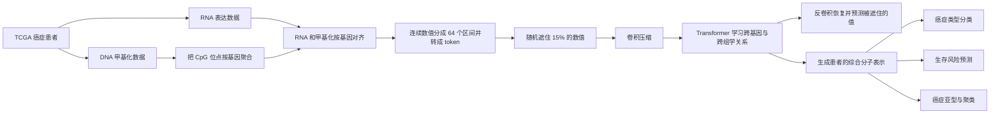

# MOJO 论文通俗讲解

## 一句话理解

**MOJO 想把同一位癌症患者的 RNA 表达和 DNA 甲基化信息放在一起学习，形成一张综合的“分子身份证”，再用它判断癌症类型、预测患者风险，并在缺少一种检测数据时仍能工作。**

## 1. 论文研究的是什么？

一名癌症患者可以有很多种组学数据。论文主要使用两种：

- **bulk RNA-seq**：测量每个基因当前表达得有多强。可以理解成“哪些基因正在大声说话”。
- **DNA 甲基化**：反映基因附近的调控状态。可以理解成基因上的“开关或锁”。

两者提供的信息不同，但存在联系。例如，某些区域甲基化程度升高，可能会抑制相关基因表达。

过去常见的做法包括：

1. 只使用 RNA；
2. 只使用甲基化；
3. 分别训练两个模型，最后再把结果拼接起来。

作者认为第三种“先各学各的、最后再拼接”的方法没有在预训练阶段充分学习两种组学之间的关系。因此提出 **MOJO：Multi-Omics JOint representation learning**，即多组学联合表示学习。

可以把论文的问题概括成：

> 能不能让模型从一开始就同时阅读 RNA 和甲基化数据，自动学习它们之间的联系，从而得到更好的患者表示？

## 2. 作者想得到什么结果？

作者主要想证明四件事。

### 第一，联合学习比单独使用一种组学更准确

MOJO 产生的患者表示应该更适合：

- 癌症类型分类；
- 患者生存风险预测；
- 乳腺癌亚型识别；
- 无监督癌症样本聚类。

### 第二，联合预训练优于最后简单拼接

作者希望证明，把 RNA 和甲基化从预训练阶段就放进同一个模型，比“分别编码后再拼接”更能学到两者之间的联系。

### 第三，模型要能处理非常高维的数据

一个患者有大约：

- 17,116 个基因表达值；
- 原始甲基化数据约 45 万个 CpG 位点。

普通 Transformer 的计算量随序列长度平方增长，直接处理这种数据会非常耗显存和时间。因此作者还希望设计一种更高效的结构。

### 第四，缺少一种组学时模型仍然可用

真实医院中，不一定每位患者都同时做过 RNA-seq 和甲基化检测。因此作者希望：

- 两种数据都有时，发挥多组学优势；
- 缺少 RNA 或甲基化时，性能不要突然崩溃。

## 3. 整个方法是怎样做的？

### 第一步：把两种组学对齐到同一批基因

RNA-seq 天然就是每个基因一个表达值。

甲基化数据则不同：一个基因附近可能对应多个 CpG 甲基化位点。作者把属于同一个基因的 CpG 位点取平均，得到一个基因级甲基化值。

最终，每个患者都表示为：

- 17,116 个 RNA 表达值；
- 17,116 个基因级甲基化值。

这样两个模态就可以按照基因一一对应。

这个处理很实用，但也会丢失不同 CpG 位点之间的精细差异。

### 第二步：把连续数值变成“单词”

语言模型处理的是 token，而 RNA 和甲基化原本是连续数值。

作者把两种数据分别划分成 64 个数值区间。例如，一个表达值落在第 20 个区间，就转换成编号 20 的 token。

这相当于把：

> “基因 A 的表达量为 3.72”

转换成：

> “基因 A 的表达水平属于第 20 档”。

此外，模型还有“基因身份嵌入”，所以它知道当前数值对应的是哪个基因，而不只是知道数值大小。

### 第三步：像 BERT 一样遮住部分数据

训练时，作者随机选取 15% 的 RNA 或甲基化 token：

- 80% 替换成 `<MASK>`；
- 10% 替换成随机值；
- 10% 保持原值，但仍要求模型预测。

模型要根据其余基因以及另一种组学的信息，把被遮住的数值猜出来。

例如：

> 模型看到了某患者大部分基因表达和甲基化数据，但 BRCA1 的表达被遮住了。模型需要利用其他基因及甲基化状态推测 BRCA1 的表达水平。

要完成这个任务，模型必须学习：

- 基因之间的联系；
- RNA 与甲基化之间的联系；
- 不同癌症样本的共同分子模式。

这就是“双模态掩码语言建模”。

### 第四步：先用卷积压缩，再使用 Transformer

17,116 个基因构成的序列对纯 Transformer 来说太长。

MOJO 先通过多层卷积不断压缩：

> 17,116 个基因位置 → 大约 67 个压缩位置

随后，8 层 Transformer 在这个较短的序列上做注意力计算。模型最后通过反卷积恢复原始长度，预测被遮住的 RNA 和甲基化值。

这种结构有点像：

> 先把一本很厚的病历压缩成几十页摘要，让 Transformer 阅读摘要，再根据摘要恢复重要细节。

这里的卷积主要承担高效压缩和多尺度信息聚合，并不表示作者认为相邻编号的基因一定在生物学上相邻。

### 第五步：提取“患者分子表示”

预训练完成后，作者从 Transformer 最后一层得到每名患者的特征，并对序列位置求平均，最终得到一个 **512 维向量**。

这个向量就是 MOJO 为患者生成的“分子身份证”。

之后可以在它上面连接一个小型神经网络，用来完成具体任务。

## 4. 下游任务分别做什么？

### 癌症类型分类

根据患者的 RNA 和甲基化数据，判断其属于 TCGA 中的哪一种癌症，共 33 类。

MOJO 的 weighted-F1 为 **0.952**：

| 方法 | Weighted-F1 |
| --- | ---: |
| 只使用 RNA 的 BulkRNABert | 0.943 |
| 只使用甲基化的 MethFormer | 0.931 |
| 两种表示直接拼接 | 0.945 |
| MOJO | **0.952** |

提升数值不算巨大，但它稳定超过单模态、后期拼接和其他多组学模型，支持了“联合预训练确实有用”的结论。

### 生存风险预测

这里不是直接预测患者还能活多少天，而是预测患者之间的相对风险排序。

例如：

> 患者 A 是否比患者 B 更可能更早发生死亡事件？

主要指标是 C-index，0.5 接近随机排序，越接近 1 越好。

| 方法 | C-index | 癌种内加权 C-index |
| --- | ---: | ---: |
| BulkRNABert | 0.749 | 0.654 |
| 直接拼接 | 0.756 | 0.653 |
| MOJO | **0.771** | **0.670** |

“癌种内加权 C-index”尤其重要，因为它避免模型仅仅依靠“某类癌症通常更危险”来得到高分，而要求模型能区分同一种癌症中的高低风险患者。

### 无监督分类和聚类

作者不微调 MOJO，而是直接观察其患者表示是否自然形成有意义的分组。

在 33 类癌症的 zero-shot 实验中：

| 方法 | 准确率 | NMI | ARI |
| --- | ---: | ---: | ---: |
| 后期拼接 | 0.870 | 0.771 | 0.620 |
| MOJO | **0.928** | **0.862** | **0.756** |

这说明 MOJO 的表示本身已经把不同癌症患者分得比较清楚，并非完全依赖后面的分类器。

## 5. 缺少一种组学时怎么办？

这是论文比较有实际意义的一部分。

最直接的方法是：如果某名患者缺少 RNA，就把整段 RNA 输入全部设置为 `<MASK>`。

问题在于，普通预训练只遮住 15% 的 token，没有见过“一整种组学全部消失”的情况。所以当作者把全部 RNA 删除时，分类 F1 从 **0.952 降到 0.538**。

为了解决这个问题，作者做了两件事。

### 扩展预训练数据

除了 9,252 名同时拥有两种数据的患者，还加入：

- 2,022 名只有 RNA 的患者；
- 560 名只有甲基化的患者。

这样模型在预训练时就能见到模态缺失的情况。

### 加入互信息辅助损失

作者希望模型面对以下三种输入时，尽量给出一致预测：

- RNA＋甲基化；
- 只有 RNA；
- 只有甲基化。

互信息损失在这里可以通俗理解成：

> 尽量不让模型的最终判断依赖“当前提供的是哪一种数据”。

加入这个损失后，即使测试时把所有 RNA 都删除，weighted-F1 也能从 **0.538 恢复到 0.916**；而两种数据完整时仍保持约 **0.949**。

## 6. 这篇论文最终证明了什么？

论文给出的证据支持以下结论：

1. **RNA 表达和 DNA 甲基化联合预训练，可以得到比单模态更好的患者表示。**
2. **从预训练开始联合建模，比最后简单拼接两个模型的结果更有效。**
3. **卷积压缩加 Transformer 能显著降低长组学序列的计算成本。**
4. **MOJO 的表示可用于癌种分类、生存分析和无监督聚类。**
5. **经过专门训练后，模型在缺少一种组学时仍能维持较高性能。**
6. **这种联合表示在未参与训练的外部 ICGC 队列上仍有一定泛化能力。**

论文还通过 SHAP、基因相关性和 GSEA 分析发现，模型用于乳腺癌亚型判断的重要表示维度与雌激素反应、蛋白分泌等已知生物通路有关。这说明它学到的并非完全无法解释的统计特征。

## 7. 阅读时需要注意的限制

这篇论文并没有证明 MOJO 已经可以直接用于医院。

主要限制包括：

- 把多个 CpG 位点平均成一个基因级数值，会损失位点级信息。
- 预训练只有 9,252 个完整配对样本，对于基础模型来说仍然偏少。
- 数据主要来自 TCGA，可能带有人群、测量平台和癌症类型偏差。
- 模型擅长风险排序，但不能据此证明某个基因或甲基化变化导致癌症。
- 完整预训练使用 TPU v4-8，并处理了约 1,920 亿个训练 token，从头完整复现成本较高。
- 使用官方预训练权重，只复现分类、生存分析或缺失模态实验，会现实得多。

因此，这篇论文最准确的定位是：

> **一个面向癌症多组学数据的高效联合表示模型，并针对临床数据中常见的模态缺失问题进行了专门设计。**
